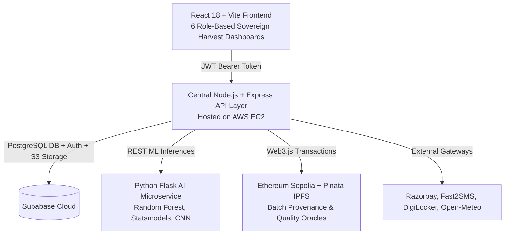

# 🌾 Sovereign Harvest: AI-Enabled Value Chain Platform for Oilseed Self-Reliance

[](https://opensource.org/licenses/MIT)
[](https://nodejs.org)
[](https://expressjs.com)
[](https://supabase.com)
[](https://vitejs.dev)
[](https://ethereum.org)
[](https://flask.palletsprojects.com)

> An enterprise-grade, multi-stakeholder agricultural value-chain platform built to bridge India's edible oil deficit. Connects **Farmers, FPOs, Processors, Retailers, and Government** through verified digital identities (DigiLocker eKYC), cryptographic provenance tracking (Ethereum Sepolia + IPFS), AI-driven price/demand forecasting (Random Forest & Statsmodels), CNN soyabean pathology diagnostics, direct marketplace settlements (Razorpay), and data-driven crop credit/insurance underwriting.

---

## 🏛️ System Architecture: 5 Connected Layers



1. **Frontend Layer**: React 18 (Vite) single-page application with 6 role-gated dashboards (*Farmer, FPO, Processor, Retailer, Government, Admin*) themed in industrial-grade **"Sovereign Harvest"** aesthetic.
2. **Backend API Layer**: Central Node.js & Express service handling RBAC JWT interception, order workflows, rate limiting, and business orchestrations.
3. **Database & Storage Layer**: Supabase PostgreSQL with 14 normalized relational entities, Row-Level Security (RLS), and 3 designated buckets (`crop-images`, `documents`, `ml-models`).
4. **AI & ML Microservice**: Python/Flask engine powering Random Forest price forecasting, Statsmodels seasonal demand decomposition, and 3-stage Conv2D CNN soyabean disease detection.
5. **Blockchain Provenance Layer**: Solidity smart contracts deployed on Ethereum Sepolia with Pinata IPFS content pinning for immutable crop lifecycle and quality certification.

---

## 👥 6 Dedicated Stakeholder Roles

| Role | Primary Dashboard Capabilities |
|---|---|
| **🌾 Farmer** | Crop cycle logging, real-time APMC price alerts, CNN leaf disease image scanner, DigiLocker eKYC, crop loan applications. |
| **🏢 FPO** | Collective member registry, aggregated bulk batch listings, input procurement, warehouse capacity allocation. |
| **🏭 Processor** | Direct lot procurement, quality parameter verification, ownership transfer verification, batch processing telemetry. |
| **🛒 Retailer / Buyer** | Marketplace browsing, checkout via Razorpay, QR-code blockchain provenance viewer, automated invoice download. |
| **🏛️ Government** | Regional crop health maps (Leaflet + Open-Meteo), price stability monitoring, district warehouse occupancy, scheme eligibility. |
| **⚙️ Admin** | Platform user management, RBAC assignments, service telemetry, broadcast announcements, smart contract oracle monitoring. |

---

## 📅 8-Week Implementation Roadmap

- [x] **Week 1: System Architecture & Database Foundation** ✅
  - 14 normalized relational tables with UUID PKs and strict foreign key relationships.
  - Row Level Security (RLS) policies on all tables.
  - Passwordless Email OTP & Google OAuth triggers with atomic profile creation.
  - Dedicated storage buckets: `crop-images`, `documents`, `ml-models`.
- [x] **Week 2: Node.js + Express Central API Layer** ✅
  - Production Express server with `helmet`, `cors`, `morgan`, and `express-rate-limit`.
  - Supabase server-side client setup (Admin service-role + Anon JWT validation client).
  - Cryptographic JWT authentication middleware (`authMiddleware.js`) and 6-role RBAC guard (`roleMiddleware.js`).
  - 11 core modular route/controller domains with input validation (`express-validator`).
  - Strict Sign Up (`409 Conflict`) and Login (`404 Not Found`) separation using `check_user_exists` RPC.
  - Ready-to-use Postman collection (`backend/postman_collection.json`).
- [ ] **Week 3: React.js (Vite) Frontend & Sovereign Harvest Design System** ⏳
- [ ] **Week 4: Ethereum Sepolia Blockchain & IPFS Traceability** ⏳
- [ ] **Week 5: AI Engine — Price Prediction & Demand Forecasting** ⏳
- [ ] **Week 6: AI Engine — CNN Pest Detection & Agrifinance Risk Scoring** ⏳
- [ ] **Week 7: Marketplace Workflows, Razorpay & Automated Invoicing** ⏳
- [ ] **Week 8: DigiLocker Sandbox eKYC & AWS EC2 Production Deployment** ⏳

---

## 📡 Backend API Endpoints (Week 2 Complete)

All routes are mounted at `/api/*` and return consistent `{ error: { message, code } }` envelopes on failure.

| Method | Endpoint | Access / Role | Description |
|---|---|---|---|
| `GET` | `/api/health` | Public | Service health & telemetry heartbeat |
| `POST` | `/api/auth/signup` | Public | Enforces unique email check; dispatches 6-digit email OTP |
| `POST` | `/api/auth/login` | Public | Verifies account existence; sends login OTP |
| `POST` | `/api/auth/verify-otp` | Public | Validates OTP, issues session tokens, confirms verification |
| `POST` | `/api/auth/refresh` | Public | Refreshes expired access tokens |
| `GET` | `/api/auth/me` | Authenticated | Fetches profile of currently logged-in user |
| `POST` | `/api/auth/logout` | Authenticated | Invalidates active user session |
| `POST` | `/api/auth/digilocker` | `farmer` | Setu DigiLocker Sandbox eKYC scaffold (Week 8 contract) |
| `GET/POST`| `/api/farmers` | `farmer`, `fpo`, `admin` | Farmer demographic & land record CRUD |
| `GET/POST`| `/api/crops` | `farmer`, `fpo` | Crop cycle sowing, harvest estimates, and acreage allocation |
| `GET` | `/api/marketplace/batches`| Authenticated | Browse available oilseed batches by grade, price, variety |
| `POST` | `/api/marketplace/orders` | `processor`, `retailer` | Place purchase orders on available inventory lots |
| `POST` | `/api/blockchain/*` | Role-gated | Smart contract scaffolds (Batch registration, ownership transfer) |
| `POST` | `/api/ai/*` | Role-gated | ML microservice scaffolds (Price forecast, pest scan, risk score) |
| `GET/PATCH`| `/api/notifications` | Authenticated | User notification feed, mark read, mark all read |
| `GET/POST`| `/api/finance/loans` | `farmer`, `government`, `admin` | Agricultural credit applications & status tracking |
| `GET/POST`| `/api/finance/insurance`| `farmer`, `government`, `admin` | PMFBY parametric insurance claim submissions |
| `GET/POST`| `/api/warehouse` | `fpo`, `processor`, `admin` | WDRA warehouse storage capacity and climate controls |
| `GET/POST`| `/api/logistics` | `processor`, `admin` | Freight dispatch, driver assignment, telemetry updates |
| `*` | `/api/admin/*` | `admin` strictly | User management, role overrides, system stats, broadcasts |

---

## 🛠️ Tech Stack

- **Backend**: Node.js (v20+), Express.js (v4), Supabase JS SDK, Helmet, CORS, Morgan, Express Rate Limit, Express Validator.
- **Frontend**: React 18, Vite, Lucide Icons, Recharts, React-Leaflet, Space Grotesk & Inter typography.
- **Database**: Supabase PostgreSQL (14 entities), Row Level Security (RLS), Realtime WebSockets.
- **AI / ML**: Python 3.10+, Flask, Scikit-learn (Random Forest Regressor), Statsmodels (Seasonal Decomposition), TensorFlow/Keras (Conv2D CNN).
- **Web3 / Blockchain**: Ethereum Sepolia, Solidity (0.8.x), Web3.js, Pinata IPFS.
- **Third-Party Services**: Razorpay Payment Gateway, Fast2SMS Gateway, Setu DigiLocker Sandbox, Open-Meteo & OpenWeather APIs, PDFKit.

---

## ⚡ Getting Started

### Prerequisites
- Node.js 22.12 or newer & npm
- Python 3.12
- Git
- Active [Supabase](https://supabase.com) Project

### 1. Install dependencies (Windows PowerShell)
Run from the repository root:

```powershell
npm ci
Push-Location backend
npm ci
Pop-Location
py -3.12 -m venv ai-service/venv
ai-service/venv/Scripts/python.exe -m pip install -r ai-service/requirements.txt
```

### 2. Configure local environment files
Copy each template once, then fill in your own Supabase credentials:

```powershell
Copy-Item .env.example .env.local
Copy-Item backend/.env.example backend/.env
Copy-Item ai-service/.env.example ai-service/.env
```

Use the anon/public Supabase key in `.env.local`. Put the service-role key only in `backend/.env` and `ai-service/.env`. Never commit active `.env` files.

### 3. Run the three services
Open three terminals at the repository root and leave each running.

Terminal 1 — Flask AI service:

```powershell
$env:AI_SERVICE_PORT=8000
ai-service/venv/Scripts/python.exe ai-service/app.py
```

Terminal 2 — Node backend:

```powershell
Push-Location backend
npm run dev
```

Terminal 3 — React frontend:

```powershell
npm run dev
```

Open the URL printed by Vite, usually `http://localhost:3000`. Backend health: `http://localhost:5000/api/health`. AI health: `http://localhost:8000/api/health`.

### 4. Verify the backend
Import `backend/postman_collection.json` into Postman and set `{{base_url}}` to `http://localhost:5000`.

---

## 📄 License
This project is licensed under the MIT License - see the [LICENSE](LICENSE) file for details.
