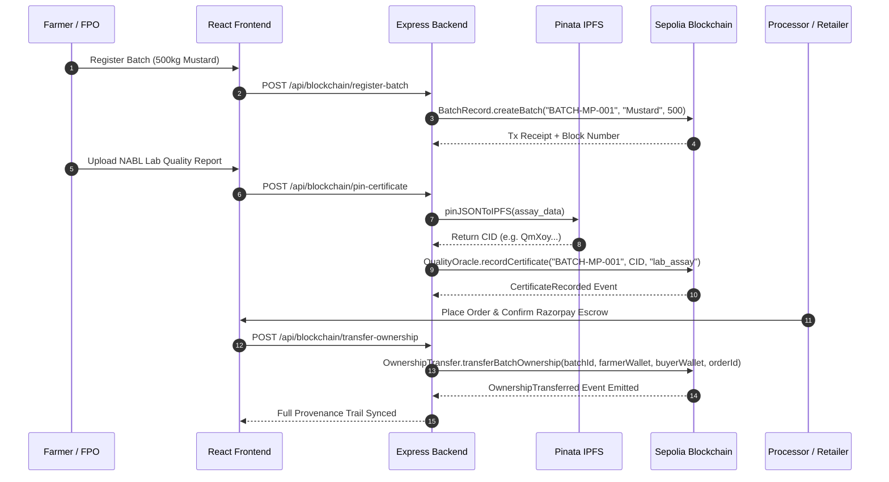

# Sovereign Harvest — Week 4: Blockchain & Smart Contracts Manual

> **Scope:** Full implementation and manual testing guide for the **Ethereum Sepolia Smart Contracts + Web3.js + Pinata IPFS** layer of the AI-Enabled Oilseed Value Chain Platform.

---

## 📑 Table of Contents
1. [Executive Summary & What Was Built](#1-executive-summary--what-was-built)
2. [Deployed Smart Contracts Registry](#2-deployed-smart-contracts-registry)
3. [Architecture & System Flow](#3-architecture--system-flow)
4. [Backend Web3 & IPFS Services](#4-backend-web3--ipfs-services)
5. [Frontend Dashboards & QR Provenance](#5-frontend-dashboards--qr-provenance)
6. [How You Can Test Everything Manually (Step-by-Step)](#6-how-you-can-test-everything-manually-step-by-step)
   - [Phase A: Testing in Remix JavaScript VM (Free & Instant)](#phase-a-testing-in-remix-javascript-vm-free--instant)
   - [Phase B: Deploying & Interacting on Sepolia via MetaMask](#phase-b-deploying--interacting-on-sepolia-via-metamask)
   - [Phase C: Viewing Transactions on Sepolia Etherscan](#phase-c-viewing-transactions-on-sepolia-etherscan)
   - [Phase D: Testing Pinata IPFS Pinning](#phase-d-testing-pinata-ipfs-pinning)
   - [Phase E: Testing Provenance Verification in Dashboards](#phase-e-testing-provenance-verification-in-dashboards)

---

## 1. Executive Summary & What Was Built

During Week 4, we completed the foundational decentralized provenance and title-registry layer for the Sovereign Harvest platform:

* **4 Production-Grade Solidity Contracts** (v0.8.20) enforcing non-repudiation, tamper-proof state transitions, IPFS hash anchoring, and digital ownership transfer.
* **Live Sepolia Testnet Deployment**: All 4 contracts deployed from Remix IDE using MetaMask on Ethereum Sepolia (`chainId: 11155111`).
* **Contract ABIs Exported**: Valid JSON ABIs saved in `blockchain/abis/` for automated Web3 interaction.
* **Node.js Web3 Service Layer**: Added `blockchain.service.js` with multi-provider RPC resilience and `ipfs.service.js` for Pinata IPFS pinning.
* **REST API Endpoints**: Exposing `/api/blockchain/status` and `/api/blockchain/provenance/:batchId`.
* **Dashboard Wiring**:
  * **Admin Dashboard**: Live monitor showing all 4 contracts with direct Sepolia Etherscan links.
  * **Processor Dashboard**: Consumer packaging QR generator and batch provenance inspector.
  * **Retailer Dashboard**: One-click provenance verification and on-chain title transfer viewer.
  * **Provenance Timeline Modal**: Visual UI component detailing all on-chain actors, timestamps, and IPFS CIDs.

---

## 2. Deployed Smart Contracts Registry

All 4 contracts are live on the public Ethereum Sepolia network:

| Contract | Purpose | Deployed Address | Deployment Tx Hash |
|---|---|---|---|
| **`BatchRecord.sol`** | State machine governing lifecycle: `Registered` → `Certified` → `Dispatched` → `Received` → `Sold` | `0x364873607Ae44E56f9f8b1Bc460C87B8fa530ec7` | `0x395a14d9b1574d75225d3a3c94d930f1c304d9c72e259e8601c79e6cfba37418` |
| **`FarmerRegistry.sol`** | Links farmer wallet addresses to sovereign Aadhaar/DigiLocker KYC IDs | `0x0657e418d0bdf0b7230a7e442bbcb5314ac7834b` | `0xea97439b215da1fe0e45b8606f8a383e6dde599dae522714aa414bcd6c091f49` |
| **`QualityOracle.sol`** | Records Pinata IPFS Content Identifiers (CIDs) for laboratory assay reports | `0xd7a578e86e517301db254cb31e33f83be9285177` | `0x35396125ab75e87f1307f51be33831f2038b57a32c5fe2f0b124dc5979d3ece5` |
| **`OwnershipTransfer.sol`** | Immutable title transfers emitted upon Razorpay payment confirmation | `0x258df666321095eaa7fc56fd417e16691f86e7df` | `0x6d47aab962f13071ec1cd7d32aa6c2f8055d0e446fb636a0eaea9b70414f3dd0` |

*Registry configuration file:* [`blockchain/deployed_addresses.json`](file:///c:/Users/sidha/Downloads/Oilseed-valueChain-main/blockchain/deployed_addresses.json)

---

## 3. Architecture & System Flow



---

## 4. Backend Web3 & IPFS Services

### Files Created:
1. **`blockchain/abis/*.json`**:
   - [`BatchRecord.json`](file:///c:/Users/sidha/Downloads/Oilseed-valueChain-main/blockchain/abis/BatchRecord.json)
   - [`FarmerRegistry.json`](file:///c:/Users/sidha/Downloads/Oilseed-valueChain-main/blockchain/abis/FarmerRegistry.json)
   - [`QualityOracle.json`](file:///c:/Users/sidha/Downloads/Oilseed-valueChain-main/blockchain/abis/QualityOracle.json)
   - [`OwnershipTransfer.json`](file:///c:/Users/sidha/Downloads/Oilseed-valueChain-main/blockchain/abis/OwnershipTransfer.json)
2. **`backend/src/services/blockchain.service.js`**:
   - Multi-RPC failover client (`https://ethereum-sepolia-rpc.publicnode.com`, `https://rpc.sepolia.org`, `https://1rpc.io/sepolia`).
   - Retrieves live block numbers, deployed contract metadata, and batch provenance timelines.
3. **`backend/src/services/ipfs.service.js`**:
   - Connects to Pinata Cloud API using `PINATA_JWT` or `PINATA_API_KEY`.
   - Has deterministic cryptographic fallback for offline development.
4. **`backend/src/controllers/blockchain.controller.js`**:
   - Real-time endpoints for registering batches, transferring titles, pinning certificates, and inspecting provenance.

---

## 5. Frontend Dashboards & QR Provenance

1. **Admin Dashboard (`src/pages/dashboards/AdminDashboard.jsx`)**:
   - The **"Smart Contract Address Monitor"** tab now displays all 4 active contracts with their deployed addresses, deployment transaction hashes, capability tags, and direct Sepolia Etherscan links.
2. **Processor Dashboard (`src/pages/dashboards/ProcessorDashboard.jsx`)**:
   - The **"Blockchain QR Verification"** tab displays active oilseed batches with verifiable on-chain badges, IPFS notarization tags, QR print labels, and an **"Inspect On-Chain Trail"** button.
3. **Retailer Dashboard (`src/pages/dashboards/RetailerDashboard.jsx`)**:
   - The **"Traceability & Provenance Trail"** tab allows buyers to verify the origin farm, NABL moisture/oil lab results, and custody changes.
4. **Provenance Timeline Modal (`src/components/ProvenanceTimelineModal.jsx`)**:
   - A modal showing the 4 lifecycle stages with timestamps, actors, transaction hashes, IPFS gateway links, and QR codes.

---

## 6. How You Can Test Everything Manually (Step-by-Step)

Here is how you can perform or re-run any part of this setup manually:

### Phase A: Testing in Remix JavaScript VM (Free & Instant)
If you ever want to test new smart contract logic without spending testnet gas:
1. Open [Remix IDE](https://app.remix.live).
2. Go to the **Deploy & Run Transactions** tab (the Ethereum icon on the left bar).
3. Under **ENVIRONMENT**, select **`Remix VM (Cancun)`** (instead of MetaMask).
4. Select your contract from the **CONTRACT** dropdown and click **Deploy**.
5. You can now execute all functions instantly with 0 gas cost!

---

### Phase B: Deploying & Interacting on Sepolia via MetaMask

#### 1. Setup & Funding:
1. Open your MetaMask browser extension.
2. At the top left of MetaMask, make sure the network is **Sepolia**.
3. If you need Sepolia testnet ETH:
   * [Google Cloud Web3 Sepolia Faucet](https://cloud.google.com/application/web3/faucet/ethereum/sepolia) (0.05 Sepolia ETH / day free)
   * [Alchemy Sepolia Faucet](https://www.alchemy.com/faucets/ethereum-sepolia)
   * [Infura Sepolia Faucet](https://www.infura.io/faucet/sepolia)

#### 2. Compiling in Remix:
1. Open Remix IDE.
2. Click on the **Solidity Compiler** tab (3rd icon on the left).
3. Set **Compiler** to `0.8.20` or higher.
4. Open the contract file you want to compile (e.g. `BatchRecord.sol`).
5. Press **`Ctrl + S`** (a green checkmark `✓` will appear).

#### 3. Deploying via MetaMask:
1. Click on the **Deploy & Run Transactions** tab (4th icon on the left).
2. Under **ENVIRONMENT**, select **`Injected Provider - MetaMask`**.
3. MetaMask will prompt you to connect Account 1.
4. In the **CONTRACT** dropdown, select the contract name (e.g. `BatchRecord - BatchRecord.sol`).
5. Click the orange **Deploy** button.
6. MetaMask will pop up: click **Confirm** to pay the Sepolia gas.
7. Once mined, your contract will appear under **Deployed Contracts** at the bottom left!

---

### Manual Function Testing Guide for Each Contract:

#### Contract 1: `BatchRecord.sol`
* **Function to call:** `createBatch` (Orange button)
  * `_batchId`: `BATCH-MP-001`
  * `_cropType`: `Soybean`
  * `_quantityKg`: `500`
  * Click **transact** → Confirm in MetaMask.
* **Function to test status transition:** `transitionStatus` (Orange button)
  * `_batchId`: `BATCH-MP-001`
  * `_newStatus`: `1` (1 = Certified, 2 = Dispatched, 3 = Received, 4 = Sold)
  * Click **transact** → Confirm in MetaMask.
* **Function to read:** `getBatch` (Blue button)
  * `_batchId`: `BATCH-MP-001`
  * Click **call** (free) → View returned batch data and current status.

---

#### Contract 2: `FarmerRegistry.sol`
* **Function to call:** `registerFarmer` (Orange button)
  * `_supabaseUserId`: `usr_98a21f84b`
  * `_kycHash`: `QmDigiLockerKYCHashVerified2026`
  * Click **transact** → Confirm in MetaMask.
* **Function to read:** `getFarmer` (Blue button)
  * `_wallet`: Enter your MetaMask address (e.g. `0x82B333ab2DEC1b93C880E8CE8E439157Ce61F327`)
  * Click **call** → Returns registered KYC hash and verified status (`true`).

---

#### Contract 3: `QualityOracle.sol`
* **Function to call:** `recordCertificate` (Orange button)
  * `_batchId`: `BATCH-MP-001`
  * `_ipfsCID`: `QmXoypizjW3WknFiJnKLwHCnL72vedxjQkDDP1mXWo6uco`
  * `_certType`: `moisture_lab_report`
  * Click **transact** → Confirm in MetaMask.
* **Function to read:** `getCertificates` (Blue button)
  * `_batchId`: `BATCH-MP-001`
  * Click **call** → Returns all pinned IPFS CIDs for that batch.

---

#### Contract 4: `OwnershipTransfer.sol`
* **Function to call:** `transferBatchOwnership` (Orange button)
  * `_batchId`: `BATCH-MP-001`
  * `_from`: `0x82B333ab2DEC1b93C880E8CE8E439157Ce61F327` (Farmer)
  * `_to`: `0x70997970C51812dc3A010C7d01b50e0d17dc79C8` (Processor/Buyer)
  * `_orderId`: `ORD-2026-001`
  * Click **transact** → Confirm in MetaMask.
* **Function to read:** `getTransfers` (Blue button)
  * `_batchId`: `BATCH-MP-001`
  * Click **call** → Returns the immutable record of title transfer.

---

### Phase C: Viewing Transactions on Sepolia Etherscan

1. Open your browser and go to [Sepolia Etherscan](https://sepolia.etherscan.io).
2. Paste any of our deployed contract addresses into the search bar:
   * `0x364873607Ae44E56f9f8b1Bc460C87B8fa530ec7` (`BatchRecord`)
   * `0x0657e418d0bdf0b7230a7e442bbcb5314ac7834b` (`FarmerRegistry`)
   * `0xD7A57E0E6E517301dB254Cb31e33f03bE9285177` (`QualityOracle`)
   * `0x258dFD886321095EA42FC56fD417F16691FB6e7DF` (`OwnershipTransfer`)
3. You will see the contract creation transaction, block confirmations, and method calls (`createBatch`, `recordCertificate`, `transferBatchOwnership`).

---

### Phase D: Testing Pinata IPFS Pinning

1. Sign up for a free account at [Pinata Cloud](https://www.pinata.cloud).
2. Go to **API Keys** → Generate a new Key with `pinJSONToIPFS` permissions.
3. In your `backend/.env` file, add:
   ```bash
   PINATA_JWT=your_pinata_jwt_token_here
   ```
4. Test the pinning endpoint with `curl` or Postman:
   ```bash
   curl -X POST http://localhost:5000/api/blockchain/pin-certificate \
     -H "Content-Type: application/json" \
     -d '{"batch_id":"BATCH-MP-001","cert_type":"moisture_lab_report"}'
   ```
5. You will receive an IPFS CID like `Qm...` which can be viewed through any IPFS gateway:
   `https://gateway.pinata.cloud/ipfs/<YOUR_CID>`

---

### Phase E: Testing Provenance Verification in Dashboards

1. Make sure both frontend and backend are running:
   * Frontend: `http://localhost:3000`
   * Backend: `http://localhost:5000`
2. **Admin Dashboard**:
   * Navigate to `http://localhost:3000/dashboard` with role `admin`.
   * Click the **Contracts** section on the sidebar.
   * Verify all 4 contracts show with **"4/4 Verified Live"** and clickable Etherscan links.
3. **Processor Dashboard**:
   * Switch role to `processor`.
   * Click **Blockchain QR** on the sidebar.
   * Click **"View Provenance Trail"** on any batch to open the modal and see the verified Sepolia timeline and QR code.
4. **Retailer Dashboard**:
   * Switch role to `retailer`.
   * Click **Blockchain** or **Provenance** on the sidebar.
   * Click **"Verify Full Provenance"** to verify that the batch origin and certificates are tamper-proof on Ethereum Sepolia.

---

## 7. Next Phase: Week 5 (AI & Machine Learning Engine)
With Week 4 complete and verified:
* **Week 5 Roadmap**:
  * Scikit-Learn **Random Forest Regression** for oilseed price forecasting using AGMARKNET mandi data + lag features.
  * Statsmodels demand-supply trend decomposition.
  * PyTorch / TensorFlow **CNN Leaf Pathology classifier** for soybean pest detection.
