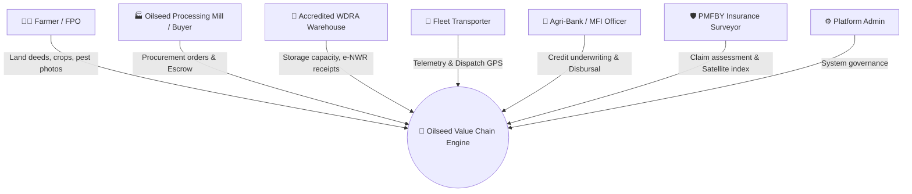
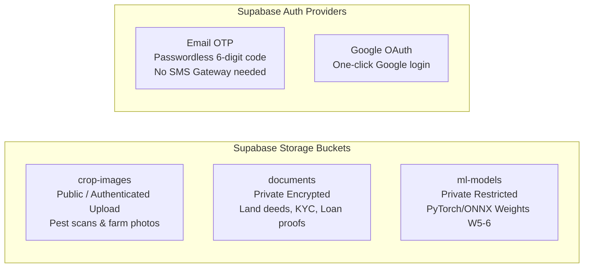

# System Architecture Document

## Title: AI-Enabled Value Chain Platform for Oilseed Self-Reliance
**Phase:** Week 1 - System Design & Database Architecture

---

## 1. Executive Summary & Vision

India is one of the largest consumers of edible oils globally, yet relies on imports for over 55-60% of its domestic edible oil requirement (costing tens of billions of dollars annually). The **AI-Enabled Value Chain Platform for Oilseed Self-Reliance** is built to bridge critical supply chain bottlenecks, empower oilseed cultivators (Mustard, Groundnut, Soybean, Sunflower, Sesame, Safflower, Castor, Niger), eliminate predatory middlemen, provide computer vision pest advisories, integrate decentralized warehousing, and streamline parametric crop insurance and AI credit scoring.

---

## 2. Multi-Stakeholder Ecosystem

---

## 3. Value Chain Stages & Technical Modules

| Value Chain Stage | Core Functions | Corresponding Tables |
|---|---|---|
| **1. Cultivation & Geo-Registry** | Farmer KYC, digitized land plots, GPS boundaries, soil metrics, sowing schedule. | `users`, `farmers`, `land_records`, `crops` |
| **2. AI Crop Protection & Telemetry** | Computer vision pest/disease diagnostics, organic/chemical treatment, microclimate logs. | `pest_reports`, `weather_logs` |
| **3. Post-Harvest & Quality Assay** | Harvest batch creation, quality lab grading (oil %, moisture %, impurities), warehouse storage. | `batches`, `warehouses` |
| **4. Direct Market & Smart Escrow** | Transparent APMC mandi price discovery, spot market orders, escrow payments. | `price_history`, `orders` |
| **5. Inter-State Agrilogistics** | Fleet assignment, vehicle tracking, proof-of-delivery timestamps. | `logistics` |
| **6. Financial Inclusion & Resilience** | AI credit score scoring, warehouse receipt financing, parametric crop insurance claims. | `loan_applications`, `insurance_claims` |
| **7. Omnichannel Alerts** | Real-time critical notifications for weather spikes, pest outbreaks, order updates. | `notifications` |

---

## 4. Security & Storage Architecture

### Row Level Security (RLS)
Every single table in PostgreSQL is protected by row-level access control:
- **Farmers** can only modify their own crops, batches, land records, loans, and claims.
- **Buyers** can only view marketplace batches and place orders.
- **Officers / Surveyors** are granted scoped access based on their verified role (`user_role`).
- **Public access** is granted read-only to benchmark mandi price histories and meteorological logs.
